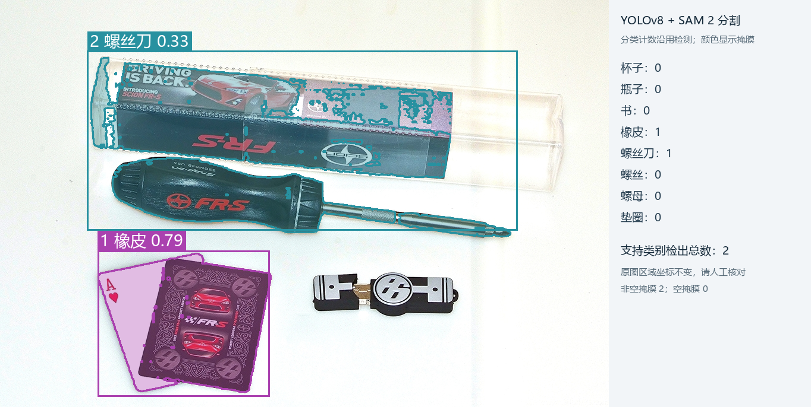
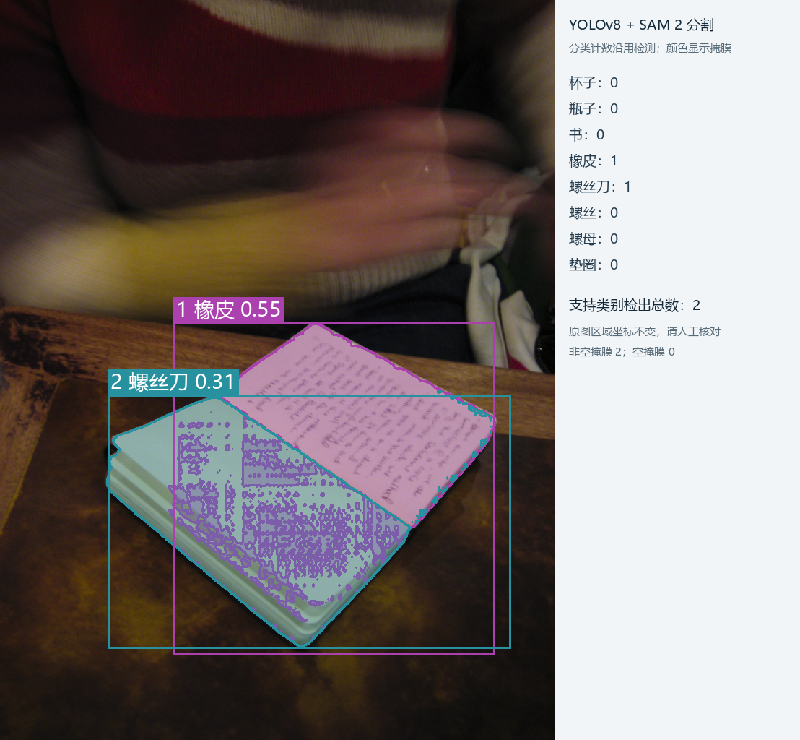

# 第八阶段：固定实验与验收报告

2026-10-24（Asia/Shanghai）。两条识别路线、统一界面与固定测试证据已准备，可进行项目功能和工程实现验收。当前结果不足以认定真实桌面识别效果合格。

## 实验协议

在首次测试推理前冻结 [协议](../reports/stage8-protocol.json)，文件 SHA256 为 `b268185811c39f10a456b1bcefeb7f531a00cc9c2425fa20087c0f34a69a8da5`。全部九张留出测试图均纳入，无挑图或重答；原图、标签、权重、源码、类别和提示哈希、依赖版本及公开调用参数随协议保存。结果见 [脱敏逐图摘要](../reports/stage8-results.json)，原始报告和图像在本机 `runs/acceptance/stage8-v1/`。验收程序见 [acceptance.py](../deskvision/acceptance.py)。

使用已复核的 64 张导出数据：train 42、val 13、test 9。测试共 29 个实例，杯子、瓶子、书、橡皮、螺丝刀各一张、一实例；其余四张固定工业袋装背景中，螺丝、螺母、垫圈各两个，共 24 实例。阶段三曾查看并制作标签，测试组此前未用于推理评估、权重选择、阈值或提示调整，因此是留出测试，但不是完全盲审。公开图片可能曾被云端预训练见过，无法核实。

原图分别交给两路，真值仅在离线汇总时使用。固定 id 排序，先完成全部本地请求，再完成全部 DeepSeek 请求。失败也保留，不自动重试；已有记录不覆盖。没有重新训练，没有依据测试结果改阈值、提示或权重。今后若用这九张图改进系统，必须另建未使用的测试集。

| 路线 | 固定设置 |
|---|---|
| YOLOv8n → SAM 2.1 tiny | 长训练最佳权重；置信度 0.25，NMS IoU 0.7，类别无关 NMS，imgsz 640，FP32，max_det 300，cuda:0；启用分割 |
| DeepSeek | 官方端点、deepseek-flash、原图字节、固定八类提示；JSON 输出，关闭思考，detail=high，60 秒超时，最多 4096 输出 token，SDK 自动重试为零 |

本地设备为 RTX 5070 Laptop GPU，环境版本完整记录在协议中。每张本地请求都重新加载 YOLO 和 SAM；第一张包含进程与设备冷启动，后续受系统缓存和设备预热影响。云端每次发出一次请求，9 次均返回 deepseek-flash。接口内部预处理和算力不同，同图并不意味着相同计算量。

## 计数指标与结果

“整图全对”要求八类计数向量全部一致，包括真值为零的类别。MAE 为成功图的八类绝对计数误差总和除以（成功图数 × 8）；零类别多会使这个数字较小，必须结合整图全对率和逐类误差阅读。“绝对误差/实例数”不是准确率，可超过 1。失败没有伪造为零计数，本次两路均无失败或缺失。

| 指标 | YOLOv8 + SAM 2 | DeepSeek |
|---|---:|---:|
| 成功覆盖 | 9/9 | 9/9 |
| 八类计数整图全对 | 7/9（77.78%） | 9/9（100%，仅此小样本） |
| 绝对计数误差总和 | 4 | 0 |
| 每图每类 MAE | 0.05556 | 0 |
| 绝对误差 / 29 个真实实例 | 0.13793 | 0 |
| 总耗时中位数 | 1253.930 ms | 2476.175 ms |
| 总耗时最小 / 最大 | 1006.971 / 13017.629 ms | 1516.237 / 3995.187 ms |

逐图如下，仅列非零类别，未列出的类别均为零：

| 测试图 id | 真值 | YOLO + SAM | DeepSeek |
|---|---|---|---|
| loco_test_000 | 螺丝2、螺母2、垫圈2 | 同真值 | 同真值 |
| loco_test_010 | 螺丝2、螺母2、垫圈2 | 同真值 | 同真值 |
| loco_test_020 | 螺丝2、螺母2、垫圈2 | 同真值 | 同真值 |
| loco_test_030 | 螺丝2、螺母2、垫圈2 | 同真值 | 同真值 |
| oi_02a90407e6bf3ef8 | 螺丝刀1 | 螺丝刀1、橡皮1 | 同真值 |
| oi_0b92046dc7f1f249 | 书1 | 橡皮1、螺丝刀1 | 同真值 |
| oi_1088928dd27d2299 | 杯子1 | 同真值 | 同真值 |
| oi_2f47847a26b41b63 | 橡皮1 | 同真值 | 同真值 |
| oi_fe400557382a38aa | 瓶子1 | 同真值 | 同真值 |

本地逐类绝对误差：书 1、橡皮 2、螺丝刀 1，其余五类为 0；DeepSeek 八类均为 0。9 张本地图均完成 SAM，输出 31 个非空掩膜、0 个空掩膜。31 是模型输出数量，不是真实物体数；无人工像素掩膜，不报告分割 IoU、Dice 或准确率。计数全对也不能证明每个框或文字位置正确。

历史验证集 mAP50=0.98469、mAP50–95=0.82935 来自阶段四的 13 张 val，不能替代本次 test 指标。本次未新增 test mAP；DeepSeek 没有输出像素框，不对它计算检测 mAP。

## 错误样例

螺丝刀图中，多检的“橡皮”实际是卡片状物体；螺丝刀框还包含包装。SAM 根据框生成轮廓，保留了原分类错误并可能描到包装。书图中，一本打开的书被分成“橡皮”和“螺丝刀”，两种掩膜还存在重叠。它们表明训练样本覆盖不足、类别区分和实例边界仍有问题；本实验没有通过调高阈值隐藏错误。

图像作者、来源、许可及叠加修改说明见 [署名](../reports/assets/README.md)。来源为 Open Images 图片（CC BY 2.0）；测试中的 LOCO 图片遵守 CC BY-NC-SA 4.0，不可默认商用。

## 耗时、用量和使用体验

总耗时包含输入校验、本次模型加载、推理或网络，以及结果写盘等工作；不含 UI 排队、上传、下载。首张本地约 13 秒，明显高于后续值，不能把这些单次请求换算为稳定 FPS，也不能据此宣称固定倍速优势。纯 GPU 推理时间与 API 网络总时间不是同一口径，未用于主表比较。常驻模型、重复运行、网络波动和显存峰值未单独基准测试。

测试九次请求合计输入 12184 token、输出 1169 token、总计 13353 token，每份响应均带 usage。没有核实历史价格或账单，不估算人民币金额。本地零 API token 不等于没有硬件、电费与维护成本。

界面演示另外使用 val 中的杯瓶图，独立测试之外只有一次成功的 DeepSeek 演示请求：输入 1154、输出 89、总计 1243 token。API 耗时 2223.576 ms，界面总耗时 2264.865 ms。YOLO 杯0瓶2，DeepSeek 杯1瓶1，图像哈希相同。演示中的本地结果总耗时 1419.838 ms；之前截图准备时也运行过本地请求，不是重复测试抽取最好答案。两路 ZIP 含 11 项，检测图、掩膜、各自报告、云端响应和数量差异均已检查。

| 需求或体验 | 本地检测与分割 | 视觉大模型 |
|---|---|---|
| 精确像素位置与后续裁剪 | 有框、掩膜和轮廓，但会错类、漏检和描错区域 | 当前接口只返回文字位置，没有像素框与掩膜 |
| 离线与原图留本地 | 已有模型与环境可离线运行 | 需网络、服务额度，并将原图发送官方端点 |
| 数量与语义说明 | 受训练数据、阈值与 NMS 影响 | 当前小测试计数较好，但仍可能幻觉、重复或漏数 |
| 工程维护 | 管理权重、标签和 GPU，新增场景需补样验证 | 管理密钥、用量、服务变化及结构化响应失败 |
| UI 操作 | 同一页面上传、运行、看图、核对、导出 | 同一页面独立生成清单，任一路失败不阻塞另一路 |

统一 UI 使比较更方便，不会让两个识别者相互提供答案。SAM 像描边工具，YOLO 像贴类别标签的人；标签贴错时，描边再完整也不会改名。

## 验收结论与改进顺序

工程流程、同图独立对比和故障处理已经形成可展示成果，57 项自动检查通过；环境检查、协议与记录哈希核验通过。Windows 下 Gradio 构建测试有未关闭事件循环的 ResourceWarning，退出码为 0；未把警告解释为模型失败。

识别效果只支持“在这九张留出图片上的计数观察”。前五类各一图、五金背景单一，缺真实桌面、负样本、遮挡、密集小物和光照变化；标签仍需用户或评审抽审。不能从 9/9 宣称云端普适 100%，也不能从 7/9 宣称本地已满足业务标准。

下一轮先补充真实桌面与容易混淆的杯瓶、书、卡片、包装等负样本，按场景或拍摄组重新划分并复核；在新验证集上改进后，使用全新测试集验收。分割精度需要另做人工掩膜，稳定性能需要单列常驻模型基准。此次按用户准备验收的要求收尾，没有在已看答案的测试组上继续调参或训练。

材料入口见 [验收与复现指南](验收与复现指南.md)，讲解与个人总结见 [项目介绍与个人总结](项目介绍与个人总结.md)。
